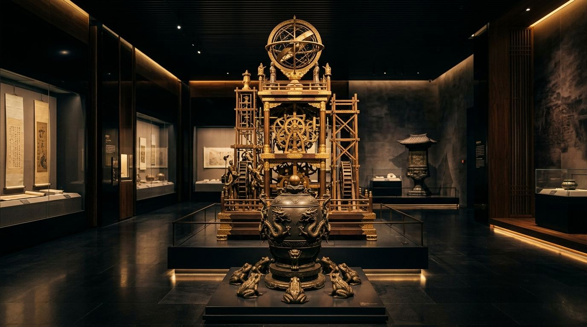
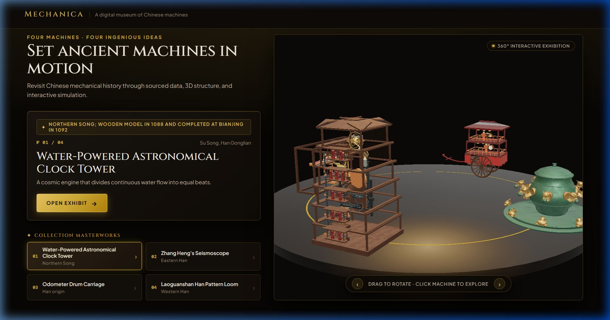
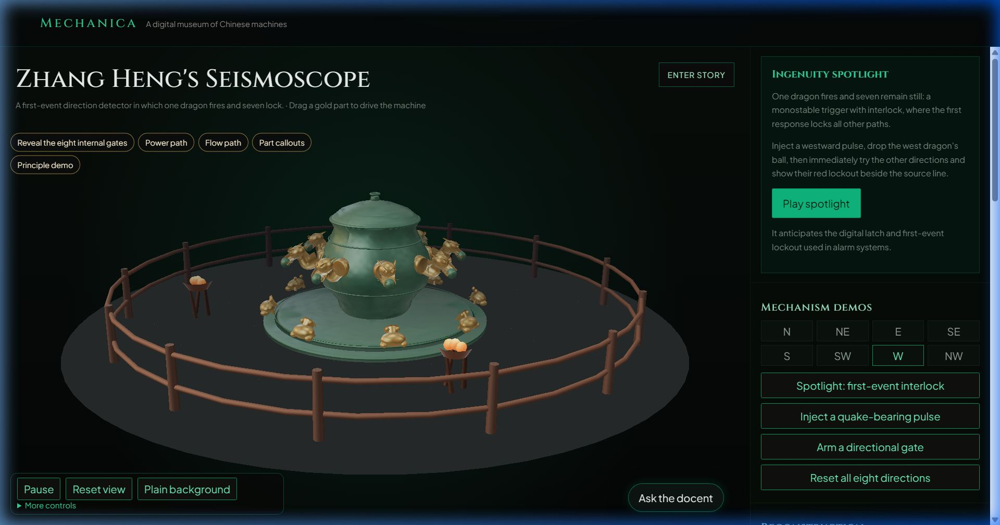

# The Inventor's Secret

> **Operable Reconstructions of Classical Chinese Mechanical Masterpieces**  
> *A museum where ancient engineering runs on verifiable physics, strict three-tier provenance, and grounded AI docentry.*



[](https://github.com/FreakyAdy/INTERACTIVE-MACHINES/actions/workflows/ci.yml)
[-34d399?style=flat-square)](https://github.com/FreakyAdy/INTERACTIVE-MACHINES)
[](https://github.com/FreakyAdy/INTERACTIVE-MACHINES)
[](./LICENSE)

---

## ⚡ The 15-Second Pitch

For centuries, the pinnacle inventions of classical mechanical engineering—such as Zhang Heng's 132 CE directional seismoscope and Su Song's 1092 CE water-regulated escapement clock—have been trapped in cryptic historical woodblocks or static fiberglass museum replicas. 

**The Inventor's Secret** resurrects these lost machines as **fully operable, physically simulated 3D reconstructions in the browser**. Built on the bedrock philosophy that *"Data is Law"*, every gear tooth count, pivot angle, and dimension carries strict three-tier archaeological provenance:
- 📜 **`wenxian`** — textually cited from ancient treatises
- 🏺 **`wenwu`** — measured directly from excavated archaeological relics
- 📐 **`tuice`** — explicitly labeled modern scholarly conjecture

Visitors do not merely spin static 3D models; they **operate the mechanisms**. You can advance escapement scoop chains, inject directional seismic shockwaves, shift gear reductions, toggle rival academic theories side-by-side, and interrogate an **AI Docent** strictly constrained to primary dynastic sources.

---

## 🏛️ The Problem & Why It Matters

Ancient mechanical computers solved complex mathematical and physical challenges centuries before the Industrial Revolution, yet learning about them faces three structural barriers:

1. **Cryptic Primary Sources**: Treatises like the Song Dynasty *Xinyi Xiangfayao* (新儀象法要) or Han Dynasty *Song Shi* contain woodcut diagrams without modern projection, scale, or assembly guides.
2. **False Certainty in Traditional Museums**: Static replicas and CGI animations often conceal historical unknowns, presenting a single speculative reconstruction as undisputed truth.
3. **The "Turntable" Trap in Virtual Exhibits**: Most digital museums offer passive 3D models with text tooltips. They never test whether the physical kinematics actually work, leaving the most crucial educational question unanswered: *how did the mechanism transfer force?*

---

## 💡 The Solution: Operable Physics & Transparent Provenance

| Principle | Traditional Digital Museums | The Inventor's Secret |
| :--- | :--- | :--- |
| **Mechanical Interaction** | Passive turntable rotations & pre-rendered video | Live, analytical kinematic simulation & interactive drive handles |
| **Evidence & Integrity** | Undocumented dimensions; hand-waved geometry | Strict three-tier provenance attached to every single component |
| **Historical Debate** | Conceals controversy behind a single display | Preserves competing scholarly schemes; swap reconstructions in 1-click |
| **Physical Validation** | Unchecked collision meshes | Automated BVH spatial validation sweeping thousands of mechanical states |
| **AI Experience** | Generic, ungrounded hallucinating chatbot | Groq-powered AI Docent strictly bound to primary dynastic source corpus |

---

## 🛠️ The Four Shipped Masterworks

The exhibition currently features four landmark ancient machines, built in full mechanical and mathematical fidelity:

```
┌────────────────────────────────────────────────────────────────────────────────────────┐
│                               THE FOUR MASTERWORKS                                     │
├──────────────────────────┬──────────────────────────┬──────────────────────────────────┤
│ Machine                  │ Dynastic Era             │ Core Kinematic Principle         │
├──────────────────────────┼──────────────────────────┼──────────────────────────────────┤
│ Water-Powered            │ Northern Song            │ Water-regulated escapement wheel │
│ Astronomical Clock Tower │ 1088–1092 CE (Bianjing)  │ with balancing trip levers and   │
│ (水运仪象台)              │ Su Song & Han Gonglian   │ celestial armillary drive train  │
├──────────────────────────┼──────────────────────────┼──────────────────────────────────┤
│ Zhang Heng's             │ Eastern Han              │ Monostable inverted pendulum     │
│ Seismoscope              │ 132 CE (Luoyang)         │ with directional crank-and-claw  │
│ (候风地动仪)              │ Zhang Heng               │ ball-drop trigger mechanism      │
├──────────────────────────┼──────────────────────────┼──────────────────────────────────┤
│ Odometer Drum            │ Han Origin / Song        │ 100:1 and 1000:1 compound gear   │
│ Carriage                 │ 1027 CE Specification    │ reduction driving automated      │
│ (记里鼓车)                │ Lu Daolong               │ wooden mallet-striker figurines  │
├──────────────────────────┼──────────────────────────┼──────────────────────────────────┤
│ Laoguanshan Han          │ Western Han              │ Four-pedal multi-shaft linkage   │
│ Pattern Loom             │ 2nd Century BCE          │ generating coordinated shedding  │
│ (老官山提花机)            │ Tomb M2, Chengdu         │ sequences for intricate jacquard │
└──────────────────────────┴──────────────────────────┴──────────────────────────────────┘
```

---

## 📸 Visual Showcase

### 1. 360° Interactive Showroom & Exhibition Dossier
The main gallery features an ancient imperial dark-lacquer and burnished gold aesthetic, pairing a 360° turntable stage with detailed engineering dossiers and catalog cards.



### 2. Deep-Dive Kinematic Inspection
Each machine features interactive controls: run/pause simulation, step-by-step playback, exploded assembly view, cutaway internal cross-sections, and individual part inspection with full dimensions and provenance tags.



---

## 🔬 What Makes It Genuinely Innovative

### 1. "Data is Law": Three-Tier Provenance Engine
Every part definition in `src/machines/<slug>/parts.json` and dimension in `src/data/machines/<slug>.json` is tagged with its provenance kind:
- `wenxian` *(Textual)*: Cites book title, chapter, and line.
- `wenwu` *(Excavated Relic)*: Cites museum accession number, tomb catalog, and measured relic bounds.
- `tuice` *(Scholarly Deduction)*: Identifies the modern scholar and reasoning behind inferred missing components.

### 2. Side-by-Side Rival Reconstructions
Rather than flattening history into one speculative guess, competing reconstructions remain first-class citizens:
- **Seismoscope**: Switch between **Wang Zhenduo's (1963)** suspended pendulum mechanism and **Feng Rui's (2005)** inverted column monostable trigger.
- **Astronomical Clock Tower**: Toggle between **John Combridge's (1964)** hinged escapement scoop scheme and the classical fixed scoop model.

### 3. Automated Poison Gate & Physical Validator
The repository features an independent validation suite (`scripts/validate.mts`) that evaluates thousands of state samples across each machine:
- Proves gear teeth mesh at exact mathematical ratios with zero invalid interpenetration.
- Verifies bounding box envelopes against excavated archaeological reports using `three-mesh-bvh`.
- **The Poison Gate (`pnpm poison`)**: A negative-control test suite that intentionally injects corrupted gear ratios, reversed directions, collision overlaps, and missing provenance into the pipeline to mathematically prove the validator catches every flaw.

### 4. AI Docent Grounded in Primary Treatises
The integrated docent drawer is powered by **Groq (`llama-3.3-70b-versatile`)** or the OpenAI Responses API. Unlike typical conversational bots that hallucinate details, the docent:
- Receives system prompts assembled exclusively from verified machine data and primary source texts.
- Formats factual citations as interactive chips (`[来源:source_id]`) that link directly to parts in the 3D viewer.
- Automatically refuses to guess or invent specs for unrecorded questions, safeguarding academic integrity.

---

## 🏗️ Architecture & Technology Stack

The project runs 100% in modern browsers with zero external database dependencies:

```
┌────────────────────────────────────────────────────────────────────────┐
│                        CLIENT APPLICATION                              │
│                                                                        │
│   React 19 + TypeScript (Strict)           Zustand (UI & Simulation)   │
│   Vite 6 (ES2022 Bundler)                  i18next (Bilingual Engine)  │
│                                                                        │
│   Three.js (^0.179)                        @react-three/fiber & drei   │
│   three-mesh-bvh (Spatial Collision)       Custom Involute Profile Gen │
└────────────────────────────────────┬───────────────────────────────────┘
                                     │
                                     ▼
┌────────────────────────────────────────────────────────────────────────┐
│                       DATA & VALIDATION CORE                           │
│                                                                        │
│   Kinematic Graph (src/sim/graph.ts)      Three-Tier Provenance Store │
│   Part Schema & Relic Bounds               Deterministic Validator     │
└────────────────────────────────────┬───────────────────────────────────┘
                                     │
                                     ▼
┌────────────────────────────────────────────────────────────────────────┐
│                        AI DOCENT BACKEND                               │
│                                                                        │
│   api/docent.ts (Serverless Function)      Groq / OpenAI SSE Streaming │
│   In-Memory Rate Limiter                   Source Citation Verifier    │
└────────────────────────────────────────────────────────────────────────┘
```

---

## 🎯 Connection to Buildathon Theme

**Category**: Education & Cultural Heritage  
*The Inventor's Secret* addresses a fundamental educational paradox: ancient mechanics cannot be preserved in words alone, but physical museum replicas are too fragile to be operated by the public. By translating cryptic dynastic records into verified, interactive 3D code, we provide students, historians, and engineers worldwide with an **operable virtual laboratory** to explore human mechanical ingenuity.

---

## 🚦 Verification & Test Coverage

The project enforces deterministic CI quality gates:

- **268 Unit Tests Across 30 Test Suites** passing:
  ```bash
  pnpm test
  ```
- **Rigorous Mathematical Kinematics & Bounding Sweep**:
  ```bash
  pnpm validate
  ```
- **Negative Control Poison Needle Suite**:
  ```bash
  pnpm poison
  ```
- **End-to-End Browser Scenarios** (Playwright):
  ```bash
  pnpm e2e
  ```

---

## 🚀 Quickstart & Local Installation

### Prerequisites
- Node.js `20.x` or higher
- `pnpm` (version 9 recommended)

### 1. Clone & Install
```bash
git clone https://github.com/FreakyAdy/INTERACTIVE-MACHINES.git
cd INTERACTIVE-MACHINES
pnpm install
```

### 2. Start the Development Server
```bash
pnpm dev
```
Open [http://localhost:5173](http://localhost:5173) in your browser.

### 3. Build for Production
```bash
pnpm build
pnpm preview
```

---

## 🤖 Optional AI Docent Configuration

The core 3D museum functions completely offline without any API keys. To enable the live AI Docent Q&A drawer:

1. Create a `.env` file in the project root (see [`.env.example`](./.env.example)):
   ```env
   # Groq API Configuration (Recommended)
   GROQ=your_groq_api_key
   GROQ_MODEL=llama-3.3-70b-versatile
   DOCENT_ACCEPT_APPROX_LIMITS=1
   ```
2. Alternatively, configure `OPENAI_API_KEY=your_key` for OpenAI GPT models.
3. If no key is set, the docent entry button gracefully hides itself, leaving the 3D museum fully interactive.

---

## 🌐 Deployment Ready

The project includes pre-configured, zero-config deployment manifests:
- **GitHub Pages**: Automated workflow in [`.github/workflows/deploy.yml`](./.github/workflows/deploy.yml) builds and publishes on push to `main`.
- **Vercel**: Pre-configured [`vercel.json`](./vercel.json) with SPA rewrites and 1-year immutable caching for Three.js 3D assets.
- **Netlify**: Pre-configured [`netlify.toml`](./netlify.toml) with cache control headers.

---

## 📜 Historical Primary Sources

The models and dimensions in this repository cite the following historical records:
- **Su Song (苏颂) & Han Gonglian (韩公廉)**, *Xinyi Xiangfayao* (新儀象法要), 1092 CE.
- **Zhang Heng (张衡)**, *Hou Han Shu: Biography of Zhang Heng* (后汉书·张衡传), 5th Century CE.
- **Lu Daolong (卢道隆)**, *Song Shi: Carriage and Garment Records* (宋史·舆服志), 1027 CE.
- **Chengdu Institute of Cultural Relics and Archaeology**, *Excavation Brief for M2, Laoguanshan Cemetery, Chengdu* (成都老官山M2提花织机发掘简报), 2013.

---

## 📄 License

MIT © Caleb Wei and Mechanica Contributors. Physical and archival dimensions follow open academic research records under the provisions in [`MECHANICA_PLAN_EN.md`](./MECHANICA_PLAN_EN.md).
